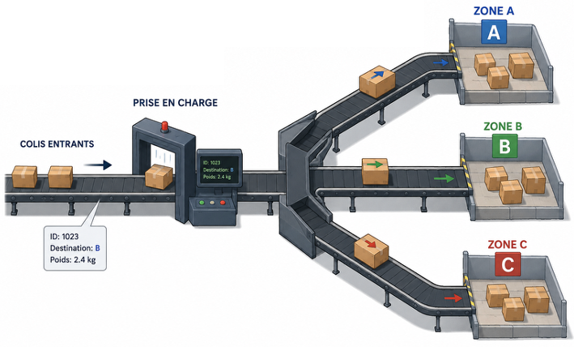
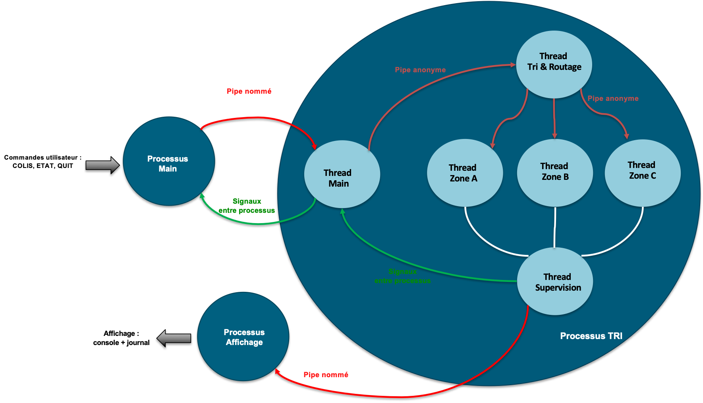

# SAÉ Système - Centre de tri de colis

## 1- Principe de fonctionnement

On souhaite simuler le fonctionnement simplifié d’un centre de tri de colis. Le centre reçoit successivement des colis. Chaque colis possède un *identifiant* unique, une *zone de destination* (parmi A, B et C), et un *poids* exprimé en kilogrammes. Lorsqu’un colis arrive dans le centre, il doit être pris en charge puis dirigé vers la zone correspondant à sa destination.

  

### Structure :

- *Colis* : identifiant, destination (A, B ou C), poids en kg
- *Zones* : A, B et C chacune totalise le nombre de colis reçus et le poids total reçu

### Traitement d’un colis

1. *Réception* : l’utilisateur signale l’arrivée d’un colis via la commande

   `COLIS <id> <destination> <poids>`

2. *Validation* : un colis est pris en compte si son identifiant n’est pas vide, sa destination vaut A, B ou C, et son poids est strictement positif. Une commande invalide ne doit pas arrêter le programme.
3. *Routage* :
   1. le colis est dirigé vers la zone correspondant à sa destination
   2. les statistiques de cette zone sont mises à jour (nombre de colis, poids total, etc.)
   3. les statistiques globales du centre sont mises à jour (nombre de colis traités, poids total, dernier colis pris en charge, etc.)

Les zones A, B et C fonctionnent indépendamment et peuvent traiter simultanément les colis qui leur sont adressés.

### Conditions de fin

- *Objectif* : le centre a traité 20 colis valides. La simulation s’arrête automatiquement.
- *Arrêt demandé* : l’utilisateur saisit la commande QUIT.

## 2- Ce que vous devez mettre en place

En trinôme, vous devez mettre en place le centre de tri de colis tel que décrit par l’illustration ci-dessous et les consignes suivantes.

  

### Mise en place par étapes

1. Un premier processus, le processus « main », est à mettre en place. Son rôle est de récupérer les commandes utilisateurs (COLIS, ETAT, QUIT) permettant au centre de fonctionner. Les commandes COLIS sont ensuite écrites dans un pipe nommé vers le second processus, le processus « TRI », qui réalisera la logique attendue derrière ces commandes.

2. Le processus « TRI » est composé de 6 threads ayant chacun un rôle défini. Ces threads devront communiquer et se synchroniser pour assurer le bon fonctionnement du centre de tri.

   a) Le thread « Main » doit mettre en place les autres threads, gérer leur synchronisation et gérer les commandes qu’il doit lire sur le pipe nommé partagé avec le processus « Main ». Les commandes COLIS seront transmises au thread « Tri & Routage » par le biais d’un pipe anonyme. La commande QUIT est gérée par le thread « Main », qui devra alors proprement stopper l’exécution de tous les processus, à l’aide de signaux.

   b) Le thread « Tri & Routage » se chargera de valider chaque colis reçu et de déterminer sa zone de destination. Il transmettra ensuite les colis aux threads « Zone A », « Zone B » et « Zone C » par le biais de 3 pipes anonymes distincts, un pour chaque zone.

   c) Le thread « Supervision » se chargera de récupérer les informations provenant des trois zones, de mettre à jour les statistiques globales du centre et de vérifier si l’objectif de 20 colis traités est atteint. Il transmettra l’état courant du centre au processus « affichage » par le biais d’un pipe nommé et communiquera avec le thread « principal » à l’aide de signaux.

   d) Les threads « Zone A », « Zone B » et « Zone C » représentent les 3 unités de traitement du centre de tri. Chaque thread reçoit les colis qui lui sont destinés, assure leur prise en charge et met à jour les statistiques de sa zone (nombre de colis traités, poids total, etc.). Les 3 zones fonctionnent de manière indépendante et peuvent traiter des colis simultanément. Elles devront communiquer les informations nécessaires au thread « Supervision ». Le choix du mécanisme de communication et de synchronisation entre les threads des zones et le thread « Supervision » est laissé à votre choix et devra être justifié.

   e) Le thread « Supervision » se chargera de vérifier si l’objectif de 20 colis traités est atteint, et de transmettre l’état courant du centre au processus « affichage » par le biais d’un pipe nommé.

3. Le processus « affichage » affiche l’état du centre de tri aux utilisateurs dans la console et conserve un historique des colis traités dans un fichier de journalisation. Il communiquera et se synchronisera avec le processus « tri » par le biais de signaux.
